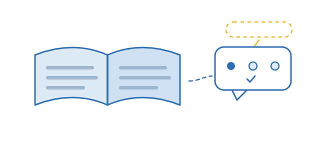

# 学习答疑老师 · Study Tutor

> 一个会**先在心里把问题拆开、想清楚，再开口**的 AI 学习搭子。

大多数 AI 答疑是这样的：你说“我不懂对偶问题”，它就把对偶问题从头到尾讲一遍——讲的是它想讲的，不是你卡住的那一步。

学习答疑老师反过来：**先判断你真正想问什么、缺的是哪一块**，再决定怎么讲。它可能只补一个前置概念、换一个类比，或者反问一句确认方向；也可能直接给你答案。没有固定套路，只有对症。

**核心不在“回答模板”，而在“回答之前的思考”。** 那部分就在 [`cordis.patch.yml`](cordis.patch.yml) 里，不到一百行——建议先自己用几天，再去看它到底在想什么。



## 它是什么

一个 **DeepSeek Harness（DSH）智能体预设**，安装后在新建对话的智能体列表里出现「学习答疑老师」。它专门面向理论书自学场景（机器学习、统计、算法……），配一个可检索的本地知识库效果最好。

跟“换个提示词让 AI 扮演老师”不同，它改的是回答**之前**的那一步：问题解构、意图判断、前置概念缺口定位，都发生在内部，不打印给你看；你看到的是一段正常的、对症的讲解。

## 适合谁

- 在啃周志华《机器学习》（西瓜书）、南瓜书《机器学习公式详解》这一类专业书的自学者；
- 已经给书做了 PDF 检索 / 原页渲染核对的 DSH 用户；
- 想要“被教”而不是“被灌输”的人。

## 安装

这是一个 DSH bundle（含一个智能体预设）。DSH Desktop 中：

1. 把本仓库克隆到你想用于学习的工作区（或任意目录）：

   ```powershell
   git clone https://github.com/YOUR_NAME/study-tutor.git
   ```

2. 打开 DSH → **Plugins** → **Add plugin** → 选择该目录；
   或者让 agent 执行 `plugin_manager` 的 `install_bundle`，`target` 传该目录的绝对路径。

3. 新建对话，在智能体选择里选「学习答疑老师」。不用重启。

## 它和你的工作区

预设会自动加载工作区的记忆链路，这是它“不失忆”的关键：

| 文件 | 作用 |
| --- | --- |
| `AGENTS.md` / `MEMORY.md` | 长期记忆、约定、进度 |
| `kb/` | 书的全文检索 + 原页渲染核对脚本 |
| `notes/` | 章节笔记、概念与公式索引 |

没有这些也能用，只是会退化成一位普通的老师。仓库不含任何书籍原文或私有笔记。

## 自定义

| 路径 | 内容 |
| --- | --- |
| `cordis.patch.yml` | persona（思考协议与教学原则）与工具清单 |
| `locale/zh.json`、`locale/en.json` | 名称、描述、详情页入口 |
| `icon.svg`、`docs/preview.svg` | 图标与 640×300 插图 |

改 persona 后需要重新安装该 bundle（Plugins 里重装一次）；只改 `locale/`、`docs/`、`icon.svg` 不用重装。

## TL;DR (English)

`dsh-study-tutor` is a DeepSeek Harness agent preset for self-studying technical books. What sets it apart is not the answer template but the thinking *before* the answer: it deconstructs the question, infers what you actually need, and only then teaches — naturally, without exposing its own diagnostic process. Pairs well with a local PDF search + page-render knowledge base. MIT licensed.

## License

MIT. 本项目只包含提示词与插件配置，不包含任何书籍内容。
